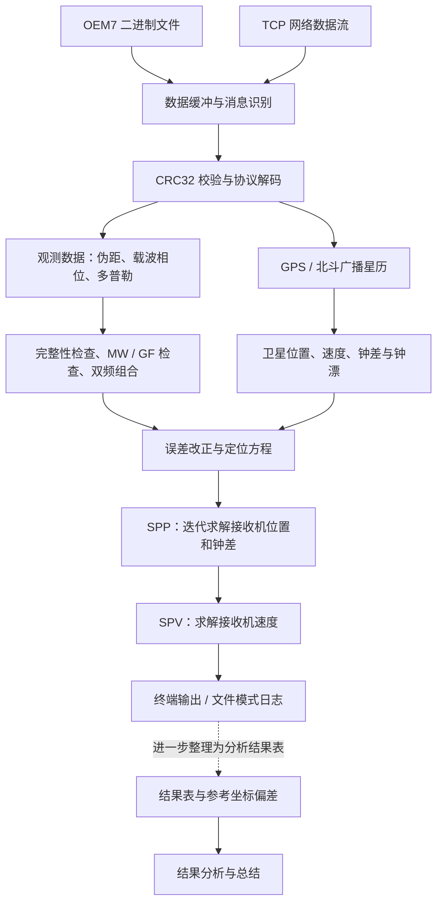

# Navigation：GPS / BDS 双系统单点定位与测速

> 使用 C++ 处理 GNSS 接收机原始观测数据，计算接收机的位置和速度，并通过 Python 分析、展示解算结果。

本项目是一个卫星导航算法实践项目，包含 **Windows 和 Linux 两个平台的代码版本、实验结果、绘图脚本及设计报告**。

程序从接收机输出的二进制数据或网络数据流中读取观测信息，完成协议解码、数据检查、卫星轨道计算和误差改正，再通过最小二乘方法求解接收机的位置与速度。

| 项目要素 | 内容 |
|---|---|
| 主要语言 | C++、Python |
| 导航系统 | GPS、BDS |
| 核心功能 | 单点定位 SPP、单点测速 SPV |
| 数据输入 | NovAtel OEM7 格式二进制数据、TCP 网络数据流 |
| 数值计算 | Eigen 矩阵库、迭代最小二乘 |
| 平台组织 | `win/` 与 `linux/` 两个版本 |
| 构建方式 | Visual Studio、CMake |
| 结果分析 | pandas、NumPy、Matplotlib |
| 项目资料 | 源代码、观测数据样例、结果表、图表、设计报告 |

## 1. 入口

- [Linux 版本源码](Navigation_SPPSPV/linux/)
- [Windows 版本源码](Navigation_SPPSPV/win/)
- [完整设计报告](Report/Report.pdf)
- [已有实验结果](Result/)

## 2. 项目概述

本项目从接收机已经生成的数字观测数据入手，读取卫星信息、测距信息和信号频率变化信息，再完成位置与速度计算。

例如：

1. 接收机观测到多颗 GPS 和 BDS 卫星。
2. 程序从二进制消息中提取每颗卫星的观测值。
3. 根据广播星历计算卫星在信号发射时刻的位置。
4. 对时钟、大气传播和地球自转等影响进行处理。
5. 综合多颗卫星的观测，估计接收机的位置和时钟偏差。
6. 使用多普勒观测估计接收机速度。
7. 保存结果，并分析位置偏差、速度变化和卫星分布情况。

### 2.1 输入、处理与输出

| 环节 | 具体内容 |
|---|---|
| 输入 | 接收机原始二进制消息，包含观测数据与广播星历 |
| 处理 | 消息解码、质量检查、卫星状态计算、误差改正、位置与速度求解 |
| 输出 | 地心坐标、经纬度、椭球高、三维速度、接收机钟差和质量指标 |
| 分析 | 位置偏差曲线、速度曲线、卫星数量曲线、PDOP 曲线 |

### 2.2 项目说明

| 分类 | 详细内容 |
|---|---|
| C++ 数据处理 | 使用结构体组织观测数据、星历和解算结果 |
| 二进制协议解析 | 识别消息同步头、解析字段、校验 CRC32、保留未完整接收的数据 |
| 网络编程 | 使用 Socket 接收 TCP 数据流 |
| 数值计算 | 构建设计矩阵、迭代求解未知参数、计算残差与几何指标 |
| 算法实现 | 将卫星轨道、误差模型和定位测速公式组织成程序模块 |
| 平台适配 | 分别处理 Windows 与 Linux 的网络接口、编译和工程配置 |
| 数据分析 | 使用 Python 读取结果表，生成图表并辅助检查解算表现 |

## 3. 整体处理流程



### 3.1 数据接入与解码

程序支持两种输入模式：

| 模式 | 数据来源 | 适用场景 |
|---|---|---|
| 文件模式 | 已保存的 OEM7 二进制文件 | 离线调试、学习算法、重复运行实验 |
| 网络模式 | TCP 数据服务 | 接收持续到来的观测数据 |


### 3.2 观测检查与双频组合

当前代码主要处理：

- GPS 的 L1、L2 双频观测。
- BDS 的 B1I、B3I 双频观测。


### 3.3 卫星状态与误差改正

根据广播星历，计算信号发射时刻的卫星位置、速度、钟差和钟漂。

相关代码还包含：

- 星历健康状态与时效检查。
- GPS 与北斗时间系统转换。
- 北斗 GEO 卫星的专门计算分支。
- 地球自转改正。
- 相对论效应改正。
- 对流层延迟改正。
- 北斗相关群延迟处理。

### 3.4 单点定位与测速

定位模块通过迭代最小二乘更新接收机位置及钟差，测速模块根据多普勒观测、卫星速度和钟漂信息求解接收机速度。

当前核心求解采用普通最小二乘矩阵形式。位置与速度的结果需要结合观测数量、几何条件、残差和参考数据共同评价。

## 4. 仓库结构与模块说明

以下展示主要源码和资料，省略缓存与编译输出。

```text
Navigation/
├── README.md
├── .gitignore
├── Navigation_SPPSPV/
│   ├── linux/
│   │   ├── CMakeLists.txt
│   │   ├── GPS_Structs.h
│   │   ├── RTKNav.cpp
│   │   ├── Decode.cpp
│   │   ├── SatPVTCalculation.cpp
│   │   ├── ErrorCorrect.cpp
│   │   ├── SPP.cpp
│   │   ├── CoordinateSystem.cpp
│   │   ├── TimeChange.cpp
│   │   ├── MatrixModule.cpp
│   │   ├── AngleChange.cpp
│   │   ├── sockets.cpp
│   │   └── oem719-202603111200.bin
│   └── win/
│       ├── GPS_Structs.h
│       ├── RTKNav.cpp
│       ├── Decode.cpp
│       ├── SatPVTCalculation.cpp
│       ├── ErrorCorrect.cpp
│       ├── SPP.cpp
│       ├── 其他基础计算模块
│       └── Debug/
│           ├── Debug.sln
│           └── Debug/
│               └── Debug.vcxproj
├── Result/
│   ├── oem.log
│   └── result.txt
└── Report/
    ├── Report.pdf
    └── fig/
        ├── ENUPlot.py
        ├── VelocityPlot.py
        ├── SatNumPlot.py
        ├── PDOPPlot.py
        └── 结果图表
```

| 模块 | 职责 |
|---|---|
| `RTKNav.cpp` | 程序入口，组织数据读取、解码、定位、测速和输出 |
| `GPS_Structs.h` | 定义数据结构、物理常量、模式开关和函数声明 |
| `Decode.cpp` | OEM7 消息识别、CRC32 校验、观测与星历解码 |
| `SatPVTCalculation.cpp` | 卫星位置、速度、时钟计算及相关改正 |
| `ErrorCorrect.cpp` | 对流层改正、观测检查及双频组合 |
| `SPP.cpp` | 单点定位 SPP 与单点测速 SPV |
| `CoordinateSystem.cpp` | 坐标转换、距离和卫星高度角等计算 |
| `TimeChange.cpp` | 常用时间、儒略日和 GPS 时间之间的转换 |
| `MatrixModule.cpp` | 坐标旋转等矩阵运算 |
| `AngleChange.cpp` | 角度与弧度转换 |
| `sockets.cpp` | 网络连接与关闭 |
| `Report/fig/*.py` | 读取结果表并绘制分析图表 |

推荐从 `RTKNav.cpp` 开始阅读，再沿着主函数中的调用顺序查看各个模块。

## 5. 实验结果

| 资料 | 内容 |
|---|---|
| [设计报告](Report/Report.pdf) | 项目设计与实验说明 |
| [运行日志](Result/oem.log) | 已保存的位置、速度、钟差和质量指标 |
| [分析结果表](Result/result.txt) | 包含坐标、参考坐标、ENU 偏差、速度等字段的表格 |

当前归档结果表的首尾时间为 GPS 周 2421 的 541823 秒至 GPS 周 2422 的 29767 秒，首尾跨度约 **25 小时 46 分钟**。这是数据时间跨度，不代表期间每一秒都有有效结果。

现有绘图脚本选取首个历元开始的 24 小时时间窗口进行展示。


## 6. 程序运行

### 6.1 软件依赖

| 用途 | 依赖 |
|---|---|
| C++ 数值运算 | Eigen 3 |
| Linux 编译 | 支持 C++14 的编译器、CMake |
| Windows 编译 | Visual Studio 2022、C++ 桌面开发组件及 Windows SDK |
| 结果绘图 | Python 3、pandas、NumPy、Matplotlib |

Linux 的 CMake 配置使用 C++14，并尝试查找 Eigen、线程库和可选的 OpenMP。建议使用较新的 CMake，例如 3.16 或以上版本。

### 6.2 选择数据模式

两个平台版本各自的 `GPS_Structs.h` 中都有：

```cpp
#define FILEMODE 0  // 1-file 0-ip
```

| 设置 | 含义 |
|---|---|
| `FILEMODE 1` | 从本地二进制文件读取数据 |
| `FILEMODE 0` | 从网络连接接收数据 |
